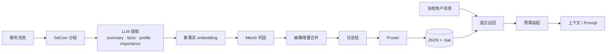

# Forevermem

> 给 AI 伴侣的长期记忆引擎：本地优先、画像与剧情分离、可看可改可删。

[](https://github.com/foreverOVOnlyou/forevermem/actions/workflows/ci.yml)
[](LICENSE)

Author: [foreverOVOnlyou](https://x.com/foreverOVOnlyou)  
Repository: https://github.com/foreverOVOnlyou/forevermem

---

## 这是什么

Forevermem 是一个用 Swift 写的长期记忆库，解决一个很具体的问题：

> 聊得越久，AI 越容易忘；把全部聊天塞回上下文，又贵又慢。

它把记忆拆成两类：

- **人物画像（Profile）**：稳定的偏好、关系、边界、身份
- **剧情记忆（Plot）**：发生过的约定、事件、话题总结

然后按相关性、新近度、重要性和访问频率召回，不再把整段历史原样塞给模型。

它适合：

- AI 伴侣、角色扮演、长期陪伴类 App
- 需要跨会话记住用户的个人助手
- 跑在自己设备上的本地优先聊天工具
- 想给现有 Chat API 补一层长期记忆的项目

它**不是**：

- 托管后端或云服务
- 向量数据库
- 聊天 UI
- 模型本身
- Mem0 / SeCom / MOOM 的官方实现

---

## 为什么不是“把聊天记录全存下来”

单纯保存记录，解决不了三个问题：

1. **上下文成本**：历史越长，每轮 token 越贵
2. **噪声**：旧事、寒暄、重复内容会稀释当前对话
3. **漂移**：只做摘要，旧偏好会被新摘要覆盖

Forevermem 的做法是：

- 稳定的进 Profile
- 发生过的进 Facts / Day summaries
- 最近的原文单独留预算
- 旧的、低强度的归档，而不是无限膨胀
- 每条事实保留来源消息，可追溯、可删除

---

## 核心能力

- 画像增量合并：旧条目不会因为一次总结没提到就消失
- Facts + Mem0 式巩固：ADD / UPDATE / DELETE / NOOP
- SeCom 式话题分段：不确定性由本地算法处理
- 向量 + 词法混合召回
- 日总结 / 证据窗口 / 最近原文三层预算
- 访问强化与 Ebbinghaus 风格衰减
- 容量控制、归档、墓碑
- 原子 JSON 存储、备份、旧数据迁移
- 编辑、置顶、删除、导出、清理 API
- 可替换 Prompt
- 不依赖任何特定模型供应商

---

## 架构



写入链路：

```text
消息
  → 话题分段（6–30 条，45 分钟间隔）
  → 一次 LLM：summary + facts + profile.items + importance
  → 新事实 embedding
  → Mem0：ADD / UPDATE / DELETE / NOOP
  → 画像条目增量合并
  → 日总结 + Pruner
  → JSON 原子写入
```

读取链路：

```text
Profile
  → Social
  → Facts
  → Evidence（原文窗口）
  → Day summaries
  → Legacy capsules
  → Recent originals（独立硬预算）
```

---

## 记忆分层

| 层 | 存什么 | 怎么用 |
|---|---|---|
| Profile | 稳定身份、偏好、关系、边界 | 最高优先级注入 |
| Facts | 承诺、偏好、事件、关系变化 | 词法/向量召回，可编辑 |
| Day summaries | 一个话题段落的剧情总结 | 向量/词法召回旧事 |
| Evidence | 从聊天原文重建的窗口 | 摘要冲突时以原文为准 |
| Recent | 最后一次压缩后的最近原文 | 固定 6k 硬预算 |
| Capsules | 旧版压缩胶囊 | 只读兼容，新会话不再创建 |
| Social | 通话、拒接、社交事件 | 最近事件补充 |

---

## 快速开始

### 1. 添加依赖

Xcode：

```text
File → Add Package Dependencies
https://github.com/foreverOVOnlyou/forevermem
```

Package.swift：

```swift
.package(url: "https://github.com/foreverOVOnlyou/forevermem.git", from: "0.1.0")
```

target 依赖：

```swift
.product(name: "Forevermem", package: "forevermem")
```

### 2. 实现两个 Provider

Forevermem 不负责网络、鉴权、计费。你只需要提供：

```swift
import Forevermem

let dependencies = MemoryEngineDependencies(
    complete: { task, system, user, timeout in
        // task == .segment / .consolidation
        // 调你的 Chat API，原样返回文本
    },
    embed: { text in
        // 调你的 Embedding API；失败就 throw
    },
    recordTrace: { trace in
        // 可选：写入你自己的 trace
    },
    profilePolicy: {
        .everySegment
    },
    vectorThreshold: {
        0.62
    },
    fallbackMessages: { conversationID in
        // 调用方 messages 为空时，从你的聊天存储重建
    }
)
```

### 3. 创建 Engine

```swift
let engine = MemoryEngine(
    store: FileMemoryStore(directory: memoryDirectory),
    dependencies: dependencies
)
```

### 4. 写入与读取

```swift
await engine.summarizeCompletedSegmentIfNeeded(
    conversationID: id,
    messages: messages,
    contactName: name
)

let context = await engine.buildContext(
    conversationID: id,
    messages: messages,
    currentText: userText
)
```

---

## Prompt 可替换

默认 Prompt 在 Sources/Forevermem/MemoryPrompts.swift。  
如果默认指令不适合你的产品，可以实现：

```swift
struct MyPrompts: MemoryPromptProvider {
    func segment(transcript: String, profileContext: String?) -> MemoryPrompt {
        MemoryPrompt(system: "...", user: "...", timeout: 90)
    }

    func consolidation(
        existing: [MemoryFactRecord],
        incoming: [MemoryFactRecord]
    ) -> MemoryPrompt {
        MemoryPrompt(system: "...", user: "...", timeout: 60)
    }
}
```

然后在 MemoryEngineDependencies 里传入 prompts: MyPrompts()。

---

## 不联网的 Example CLI

不需要 API Key，不需要服务器：

```bash
git clone https://github.com/foreverOVOnlyou/forevermem.git
cd forevermem
swift run ForevermemCLI
```

它会：

1. 构造 12 条合成消息
2. 用假 LLM 生成 summary + facts
3. 写入日总结和事实
4. 调用 buildContext 召回结构化记忆

---

## 测试

```bash
swift test
```

当前 5 个 XCTest 覆盖：

- 评分半衰期
- SeCom 分段
- 文件存储 roundtrip
- Engine 写入 + 召回

CI 会在 macOS 上执行 swift test 和 Example CLI。

---

## 常见问题

### 为什么没有生成总结？

一个段落至少 6 条消息；最后一段还需要跨天或 3 小时无新消息。  
不是每条消息都会立刻变成记忆。

### 为什么画像没更新？

检查 ProfileUpdatePolicy：

- everySegment：每段更新
- every3Segments：第 3 段才更新
- daily：24 小时内最多一次
- off：只保留已有画像

### 为什么记忆没召回？

事实需要相关性 ≥ 0.12；旧胶囊 ≥ 0.18；日总结向量阈值默认 0.62。  
embedding 失败时会自动回退到词法召回。

### 为什么上下文还是很大？

总预算默认 30,000 字，其中最近原文固定 6,000 字。  
可以通过 MemoryEngineConfiguration 调整 budgets，或减少召回条数。

### 为什么 API 费用变高？

每个完成的段落会触发一次总结；如果配置了 embedding，还会为新事实生成向量；Mem0 可能再触发一次巩固。  
不需要这些能力时，可以关闭 embedding，或把 profilePolicy 设为 off。

### 旧数据怎么迁移？

FileMemoryStore 默认不读写 UserDefaults。  
需要旧版迁移时，显式传入 defaults：

```swift
FileMemoryStore(directory: url, defaults: .standard)
```

---

## 设计边界

Forevermem 负责：

- 记忆模型与 schema
- 评分、衰减、访问强化
- 话题分段
- 段落解析
- Mem0 巩固
- 画像合并
- 容量控制与归档
- 文件存储、备份、迁移
- Engine 编排

宿主负责：

- 聊天记录来源
- Chat API / Embedding API
- API Key / UserDefaults / UI
- 角色人设、世界书、产品专属 Prompt
- 记忆检查器 UI

---

## 安全与隐私

- 不保存 API Key
- 默认不记录聊天明文日志
- 记忆可能包含个人数据；宿主负责告知、删除、导出和备份策略
- 记忆文本是不可信数据，不应作为系统指令执行

详见 [Docs/Privacy.md](Docs/Privacy.md)。

---

## 当前状态

- 版本：0.1.0（实验性 API）
- 平台：iOS 17+ / macOS 14+
- Swift：5.9+
- 测试：5 个 XCTest
- CI：通过
- 许可证：MIT

路线图：

- [ ] 更多 Provider 示例（OpenAI / Anthropic / 本地模型）
- [ ] 可选的批量 embedding
- [ ] 记忆检查器的通用 SwiftUI 组件
- [ ] 更完整的评测样本

---

## 致谢

- [Ivyy-Ting/companion-memory](https://github.com/Ivyy-Ting/companion-memory)：MIT，保留了完整 notice
- Generative Agents：relevance / recency / importance 思路
- MemoryBank：Ebbinghaus 衰减与访问强化思路
- Mem0：事实巩固的 ADD / UPDATE / DELETE / NOOP 思路
- SeCom：本地话题分段思路
- MOOM：Profile / Plot 双分支思路

这些是设计参考，不代表官方实现或背书。

---

## License

MIT。见 [LICENSE](LICENSE)。
